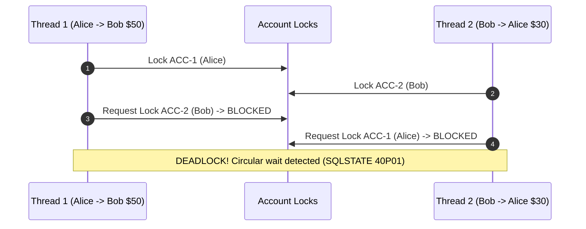

# Concurrency & Deadlock Elimination in Bilateral Transfers

This reference explains how to mathematically eliminate Coffman circular-wait deadlocks in high-concurrency financial payment engines.

---

## 1. Coffman's 4 Deadlock Conditions

Edward G. Coffman Jr. proved in 1971 that a system deadlock can only occur if all four of the following conditions hold simultaneously:

1. **Mutual Exclusion:** Only one process can hold a resource at a given time.
2. **Hold and Wait:** A process holding at least one resource is waiting to acquire additional resources held by other processes.
3. **No Preemption:** Resources cannot be forcibly confiscated from a process while it is using them.
4. **Circular Wait:** A closed chain of processes exists such that each process holds at least one resource needed by the next process in the chain ($P_1 \to P_2 \to \dots \to P_n \to P_1$).

In financial banking engines, conditions 1, 2, and 3 are unavoidable:
- Accounts require mutual exclusion to prevent double-spending.
- A transfer needs both source and destination accounts locked simultaneously.
- Transactions cannot be arbitrarily preempted without risking corrupt balances.

Therefore, **breaking Condition 4 (Circular Wait)** is the only deterministic way to make a system mathematically immune to deadlocks.

---

## 2. The Deadlock Trap in Ledger Engines

Suppose two concurrent worker threads execute bilateral transfers between Alice (Account `ACC-1`) and Bob (Account `ACC-2`):



Both threads freeze indefinitely until a database deadlock detector detects the cycle and terminates one transaction with an unhandled error.

---

## 3. The Canonical Monotonic Ordering Theorem

### Mathematical Principle
Impose a strict global partial order $<$ on all resource identifiers (e.g., lexicographical sorting on UUID or account string ID):

$$\text{id}_1 < \text{id}_2 < \text{id}_3 < \dots < \text{id}_n$$

### The Invariant
**A transaction requiring multiple resources $\{R_1, R_2, \dots, R_k\}$ must acquire locks in strictly monotonically increasing order:**

$$\text{Lock Order} = \text{sort}(\{R_1, R_2, \dots, R_k\})$$

### Proof of Circular Wait Impossibility
1. Assume for contradiction that a circular wait cycle exists:
   $$P_1 \to P_2 \to \dots \to P_n \to P_1$$
2. Let $R(P_i)$ be the highest-ordered resource held by process $P_i$.
3. For $P_i$ to wait on $P_{i+1}$, the requested resource $R_{\text{req}}$ must satisfy:
   $$R_{\text{req}} > R(P_i)$$
   by virtue of the monotonic acquisition rule.
4. Since $P_{i+1}$ already holds $R_{\text{req}}$, it follows that:
   $$R(P_{i+1}) \ge R_{\text{req}} > R(P_i) \implies R(P_{i+1}) > R(P_i)$$
5. Following the full circular chain:
   $$R(P_1) < R(P_2) < \dots < R(P_n) < R(P_1) \implies R(P_1) < R(P_1)$$
6. A value cannot be strictly less than itself. **Contradiction.**
7. Therefore, no circular wait can ever form. Deadlocks are mathematically impossible.

---

## 4. Implementation Patterns

### In Python (Application Level)
```python
# Canonical 2-account sort
first_id, second_id = sorted([from_account_id, to_account_id])

async with lock_manager.acquire(first_id):
    async with lock_manager.acquire(second_id):
        # Guaranteed deadlock-free execution
        ...
```

### In PostgreSQL (Database Level)
```sql
-- Lock accounts in deterministic ascending order
SELECT account_id, balance 
FROM accounts 
WHERE account_id IN ('ACC-BOB', 'ACC-ALICE')
ORDER BY account_id ASC
FOR UPDATE;
```
Sorting via `ORDER BY account_id ASC` before `FOR UPDATE` ensures the database engine locks the underlying physical b-tree rows in identical sequence across all parallel worker connections.
