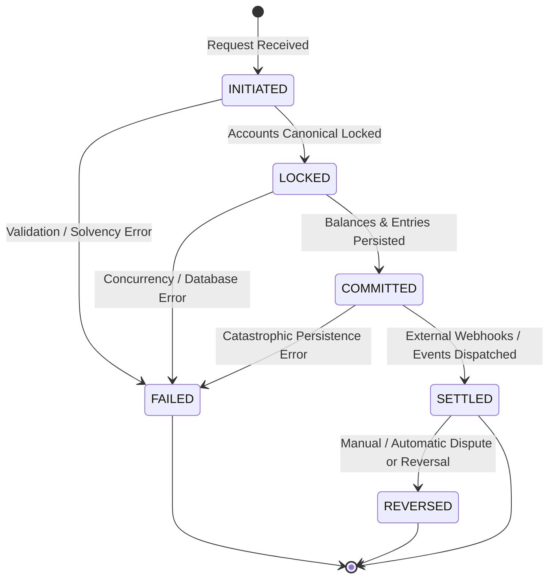

# Transaction State Machine & Lifecycle Transitions

This document specifies the deterministic finite-state machine (FSM) governing financial transaction lifecycles in LedgerCore.

---

## 1. Lifecycle State Machine Topology

---

## 2. Formal Transition Matrix

| Source State | Target State | Allowed? | Preconditions / Invariants |
| :--- | :--- | :---: | :--- |
| `INITIATED` | `LOCKED` | ✅ YES | Parameters validated; accounts found; idempotency key leased. |
| `INITIATED` | `FAILED` | ✅ YES | Solvency failure, currency mismatch, or invalid amount. |
| `INITIATED` | `COMMITTED` | ❌ NO | Illegal bypass: cannot commit without holding locks. |
| `LOCKED` | `COMMITTED` | ✅ YES | Both balances mutated; journal entries staged; sum(drift) == 0. |
| `LOCKED` | `FAILED` | ✅ YES | Rollback triggered; locks released; balances reverted. |
| `COMMITTED` | `SETTLED` | ✅ YES | Transaction durably committed in database; events published. |
| `COMMITTED` | `FAILED` | ✅ YES | Post-commit verification failure. |
| `SETTLED` | `REVERSED` | ✅ YES | Explicit reversing transaction created with opposite entries. |
| `SETTLED` | `INITIATED` | ❌ NO | Terminal state; settled money cannot be re-initiated. |
| `FAILED` | *Any State* | ❌ NO | Terminal state; failed transactions are permanently frozen. |
| `REVERSED` | *Any State* | ❌ NO | Terminal state; reversed transactions are permanently frozen. |

---

## 3. Terminal State Guarantees

### Immutability of Terminal Records
1. **`FAILED` Transactions:**
   - No balances were modified, or all changes were completely rolled back.
   - Preserves error reasons and correlation IDs for developer debugging.
   - Cannot be retried under the same transaction ID. (Clients may retry using an idempotency key depending on policy).

2. **`SETTLED` Transactions:**
   - Permanent records in the ledger.
   - Cannot be deleted or modified in place.
   - Corrections must execute a **contra-transaction** (`REVERSED`), issuing compensating debits and credits that balance out the original transfer.
