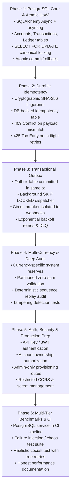

# 🛡️ LedgerCore: Enterprise Hardening & Refactoring Plan
### Bridging the Gap from In-Memory Prototype to True Distributed Financial Ledger

---

## Executive Summary & Gap Analysis

A financial ledger is judged by **what happens when hardware, networks, and processes fail**, not by the number of design patterns it implements. 

While LedgerCore features clean layered scaffolding, strong typing, and elegant in-memory concurrency primitives, a fundamental architectural gap exists between the **distributed, durable enterprise guarantees advertised** and the **actual in-memory single-process implementation**.

| Guarantee / Capability | Current Implementation (Prototype) | Target Production Architecture (Hardened) |
| :--- | :--- | :--- |
| **Persistence & Durability** | `InMemoryAccountRepository`, `InMemoryLedgerRepository` (data lost on restart) | **PostgreSQL (ACID, MVCC, asyncpg)** with schema migrations and WAL durability |
| **Transaction Atomicity** | Non-atomic: separate repo saves (`account.save()` then `ledger.append()`) | **Single Database Transaction Boundary** (`async with session.begin():`) with rollback on any failure |
| **Concurrency Control** | Local Python `threading.RLock` per account (ineffective across processes) | **Database Row-Level Locking** (`SELECT ... FOR UPDATE` with monotonic `ORDER BY id`) |
| **Distributed Idempotency** | In-memory key-to-result cache without payload checks; 120s TTL expiry | **Durable Idempotency Engine** with SHA-256 payload fingerprinting and 409 conflict detection |
| **Event Reliability** | In-memory thread queue (`worker_pool`); events silently lost on crash or full queue | **Transactional Outbox Pattern** (events committed in same DB transaction, dispatched via poller) |
| **Resilience / Circuit Breaker** | Circuit breaker wraps core transfer logic, blocking internal ledger on failures | Circuit breaker wraps **external webhook/SMS HTTP clients only**, isolated from internal ledger |
| **Accounting Invariants** | Unchecked currency sums in reconciliation; random UUID sequence tie-breakers | **Currency-specific trial balances**, deterministic monotonic sequence IDs, full journal balance replay |
| **Security & Authorization** | Unauthenticated endpoints; public money creation; wildcard CORS with credentials | **JWT / API-Key Auth**, account ownership validation, privileged admin routes, scoped tenant isolation |
| **Benchmark Integrity** | In-memory microbenchmark presented as durable system throughput; Locust reuses keys randomly | **Tiered Benchmarking Suite** (In-Memory Micro, Durable PostgreSQL, Multi-Process Chaos) |

---

## 1. Relational Database Architecture & Transactional Atomicity

### 1.1 The Root Problem: Detached Persistence
In [`ExecuteTransferUseCase.execute()`](file:///home/saimon/Emon_work/project/ledger_core/app/application/use_cases/execute_transfer.py#L270-L280):
```python
# Current code:
state_machine.transition_to(TransactionState.SETTLED)  # Transitions before persistence!
self.account_repo.save(sender)                        # Call 1
self.account_repo.save(receiver)                      # Call 2 (if this fails, sender balance mutated alone!)
self.ledger_repo.append_entries(entries)              # Call 3 (if this fails, balances mutated with no journal!)
```
This is not an atomic transaction. A crash or network timeout between Call 1, 2, or 3 leaves the ledger permanently corrupted. Furthermore, transitioning to `SETTLED` in memory before persistence means the domain model reports success even if the database write throws an error.

### 1.2 Target Architecture: The Atomic Unit of Work
All mutations must occur within a single PostgreSQL transaction context.

```
                    ┌────────────────────────────────────────────────────────┐
                    │               PostgreSQL Database Transaction          │
                    │                   (async with session.begin())         │
                    │                                                        │
Client ───────────► │  1. SELECT ... FOR UPDATE (Monotonic order by id)     │
                    │  2. Invariant validation (balance >= debit + fee)      │
                    │  3. UPDATE accounts SET balance = balance - debit      │
                    │  4. UPDATE accounts SET balance = balance + credit     │
                    │  5. INSERT INTO ledger_entries (Debits & Credits)      │
                    │  6. INSERT INTO transactions (status = 'SETTLED')      │
                    │  7. INSERT INTO idempotency_records (status, hash)     │
                    │  8. INSERT INTO outbox_events (event payload)          │
                    │                                                        │
                    │  COMMIT (All succeed atomically) or ROLLBACK (0 side-effects)
                    └────────────────────────────────────────────────────────┘
```

### 1.3 PostgreSQL Schema Design

```sql
-- 1. Accounts Table with database-enforced non-negative check
CREATE TABLE accounts (
    id VARCHAR(64) PRIMARY KEY,
    owner_name VARCHAR(255) NOT NULL,
    balance NUMERIC(18, 4) NOT NULL,
    currency VARCHAR(3) NOT NULL,
    status VARCHAR(20) NOT NULL DEFAULT 'ACTIVE',
    created_at TIMESTAMPTZ NOT NULL DEFAULT NOW(),
    updated_at TIMESTAMPTZ NOT NULL DEFAULT NOW(),
    CONSTRAINT chk_account_balance_non_negative CHECK (balance >= 0)
);

-- 2. Transactions Table (State Machine Persistence)
CREATE TABLE transactions (
    id UUID PRIMARY KEY,
    idempotency_key VARCHAR(128) NOT NULL,
    source_account_id VARCHAR(64) NOT NULL REFERENCES accounts(id),
    destination_account_id VARCHAR(64) NOT NULL REFERENCES accounts(id),
    amount NUMERIC(18, 4) NOT NULL,
    fee NUMERIC(18, 4) NOT NULL DEFAULT 0,
    currency VARCHAR(3) NOT NULL,
    status VARCHAR(20) NOT NULL, -- PENDING, SETTLED, FAILED
    error_reason TEXT,
    created_at TIMESTAMPTZ NOT NULL DEFAULT NOW(),
    updated_at TIMESTAMPTZ NOT NULL DEFAULT NOW()
);

-- 3. Immutable Append-Only Ledger Journal Table
CREATE TABLE ledger_entries (
    sequence_id BIGINT GENERATED ALWAYS AS IDENTITY PRIMARY KEY, -- Monotonic deterministic sequence
    entry_id UUID NOT NULL UNIQUE,
    transaction_id UUID NOT NULL REFERENCES transactions(id),
    account_id VARCHAR(64) NOT NULL REFERENCES accounts(id),
    amount NUMERIC(18, 4) NOT NULL, -- Negative for DEBIT, Positive for CREDIT
    currency VARCHAR(3) NOT NULL,
    balance_after NUMERIC(18, 4) NOT NULL,
    entry_type VARCHAR(10) NOT NULL, -- DEBIT, CREDIT
    created_at TIMESTAMPTZ NOT NULL DEFAULT NOW()
);

-- Revoke mutation rights on ledger entries (Audit Security)
REVOKE UPDATE, DELETE ON ledger_entries FROM ledger_user;

CREATE INDEX idx_ledger_account_sequence ON ledger_entries(account_id, sequence_id);
CREATE INDEX idx_ledger_transaction ON ledger_entries(transaction_id);
```

### 1.4 Eliminating Coffman Deadlocks in PostgreSQL
Instead of relying on local Python `threading.RLock`, row locks are ordered canonically at the database level:
```python
# Deterministic lock acquisition in SQL across all distributed API nodes
account_ids = sorted([cmd.from_account_id, cmd.to_account_id, fee_account_id])

# Query locks all participating accounts in strictly ascending lexicographical order
stmt = (
    select(AccountModel)
    .where(AccountModel.id.in_(account_ids))
    .order_by(AccountModel.id.asc())
    .with_for_update()
)
locked_accounts = (await session.execute(stmt)).scalars().all()
```
Because every competing transaction acquires locks in the exact same order ($\min(A, B) \rightarrow \max(A, B)$), **circular wait is mathematically impossible** in PostgreSQL.

---

## 2. Distributed Idempotency Engine & Request Fingerprinting

### 2.1 The Root Problem: Payload-Agnostic Replay
Currently, [`IdempotencyWrapper`](file:///home/saimon/Emon_work/project/ledger_core/app/application/decorators/idempotency_decorator.py) simply checks if a string key exists in memory and returns the cached result without inspecting what the request was.

* **Payload Mutation Attack**:
  * Request 1: `Key: tx-123`, `To: Alice`, `Amount: $100` $\rightarrow$ Processed.
  * Request 2: `Key: tx-123`, `To: Bob`, `Amount: $900` $\rightarrow$ System returns cached result of Request 1, pretending $900 was sent to Bob!
* **120-second TTL Window**: If an operation takes longer or is retried after 120s, the key lock is lost, permitting double debits.

### 2.2 Target Architecture: Cryptographic Payload Fingerprinting

```
                               Incoming Request
                    (Idempotency-Key + JSON Payload)
                                   │
                                   ▼
                Compute Deterministic SHA-256 Fingerprint
                    hash(tenant_id + from + to + amount + currency)
                                   │
                                   ▼
                   Database Lookup (idempotency_records)
                                   │
       ┌───────────────────────────┼───────────────────────────┐
       ▼                           ▼                           ▼
[Record Not Found]        [Record Exists]             [Record Exists]
       │                  Hash Matches                Hash Mismatch
       │                           │                           │
Insert IN_PROGRESS                 ▼                           ▼
Execute Transfer            Status == SETTLED?            Return 409
Commit & Mark SETTLED       ├── YES ──► Return Cached     CONFLCT
                                         Result
                            └── NO  ──► Return 425
                                         TOO EARLY
```

### 2.3 Idempotency Schema
```sql
CREATE TABLE idempotency_records (
    key VARCHAR(128) NOT NULL,
    tenant_id VARCHAR(64) NOT NULL DEFAULT 'default',
    request_hash VARCHAR(64) NOT NULL, -- SHA-256 of canonical request payload
    transaction_id UUID REFERENCES transactions(id),
    status VARCHAR(20) NOT NULL, -- IN_PROGRESS, SETTLED, FAILED
    response_payload JSONB,
    created_at TIMESTAMPTZ NOT NULL DEFAULT NOW(),
    updated_at TIMESTAMPTZ NOT NULL DEFAULT NOW(),
    PRIMARY KEY (tenant_id, key)
);
```

### 2.4 Concrete Request Lifecycle Guarantees
1. **Mandatory Header**: All POST/PUT financial mutations must require the `Idempotency-Key` header (`HTTP 400 Bad Request` if omitted).
2. **Payload Validation**: If `request_hash != stored_hash`, return `HTTP 409 Conflict` with error message `"Idempotency key was previously used with a different request payload."`
3. **In-Flight Concurrent Retries**: If `status == IN_PROGRESS`, return `HTTP 425 Too Early` or `HTTP 503 Service Unavailable` with `Retry-After: 1` header, preventing duplicate concurrent execution.

---

## 3. Dual-Write Elimination & Transactional Outbox Pattern

### 3.1 The Root Problem: In-Memory Event Loss & Misplaced Circuit Breaker
Currently:
1. Events are enqueued in an in-memory `worker_pool` after the transfer. If the queue is full, `submit()` returns `False` and the event is dropped. If the container restarts, all in-flight events are lost.
2. The Circuit Breaker wraps the **entire transfer use case** instead of external network calls. If internal transfers fail due to validation errors, the breaker trips and blocks healthy internal transfers!

### 3.2 Target Architecture: Transactional Outbox & Isolated Resilience

```
                                  PostgreSQL Transaction
┌────────────────────────────────────────────────────────────────────────────────────────┐
│  Atomic Commit:                                                                        │
│    UPDATE accounts ...                                                                 │
│    INSERT INTO ledger_entries ...                                                      │
│    INSERT INTO outbox_events (id, event_type, payload, status='PENDING') ...           │
└────────────────────────────────────────┬───────────────────────────────────────────────┘
                                         │
                                         ▼
                      Asynchronous Outbox Dispatcher Worker
                      (SELECT ... FOR UPDATE SKIP LOCKED)
                                         │
                                         ▼
                             3-State Circuit Breaker
                            (Protects external network)
                                         │
                                         ▼
                        External Webhook / Downstream HTTP
                                  (Bank / SMS)
                                         │
                    ┌────────────────────┴────────────────────┐
                    ▼                                         ▼
               [HTTP 200 OK]                            [HTTP 5xx / Timeout]
                    │                                         │
       UPDATE outbox_events                      UPDATE outbox_events
       SET status = 'DELIVERED'                  SET retry_count += 1,
                                                     next_retry = exponential_backoff()
```

### 3.3 Outbox Schema
```sql
CREATE TABLE outbox_events (
    id BIGINT GENERATED ALWAYS AS IDENTITY PRIMARY KEY,
    event_type VARCHAR(64) NOT NULL,
    aggregate_id VARCHAR(64) NOT NULL,
    payload JSONB NOT NULL,
    status VARCHAR(20) NOT NULL DEFAULT 'PENDING', -- PENDING, PROCESSING, DELIVERED, DEAD_LETTER
    retry_count INT NOT NULL DEFAULT 0,
    max_retries INT NOT NULL DEFAULT 5,
    next_retry_at TIMESTAMPTZ NOT NULL DEFAULT NOW(),
    last_error TEXT,
    created_at TIMESTAMPTZ NOT NULL DEFAULT NOW(),
    updated_at TIMESTAMPTZ NOT NULL DEFAULT NOW()
);

CREATE INDEX idx_outbox_pending ON outbox_events(status, next_retry_at) 
WHERE status IN ('PENDING', 'PROCESSING');
```

---

## 4. Multi-Currency Accounting & Rigorous Reconciliation

### 4.1 The Root Problem: Mixed Currency Sums & Shallow Reconciliation
1. **Unchecked Currency Sums**: `LedgerEntry` does not store currency; `AuditReconciliationUseCase` sums raw decimals into one total. If the database holds $-100$ USD and $+100$ EUR, the sum is $0.00$, masking currency mismatch errors.
2. **System Reserve Currency Collisions**: Account creation uses a single `ACC-SYSTEM-RESERVE`. If the first account created is USD, the reserve becomes USD. Creating a EUR account subsequently crashes with `CurrencyMismatchError`.
3. **Reconciliation Checks Only Latest Snapshot**: It compares `balance` with the latest entry's `balance_after`, using random UUIDs for tie-breaking. If an entry in the middle of history was corrupted or deleted, the audit fails to detect it.

### 4.2 Target Production Accounting Rules

1. **Currency-Specific System Reserves**:
   * `ACC-SYSTEM-RESERVE-USD`, `ACC-SYSTEM-RESERVE-EUR`, `ACC-SYSTEM-RESERVE-BDT`.
   * Each reserve is strictly isolated to its native currency.
2. **Currency-Partitioned Trial Balances**:
   * Mathematical money conservation must hold **per currency**:
   $$\forall c \in \text{Currencies}: \quad \sum \text{Debits}_c + \sum \text{Credits}_c = 0.00$$
3. **Full Journal Balance Replay Audit**:
   The reconciliation engine must independently replay the entire journal history from $t=0$:
   $$\text{Expected Balance}_A = \sum_{e \in \text{LedgerEntries}(A)} e.\text{amount}$$
   $$\text{Discrepancy} = \text{Account}.\text{balance} - \text{Expected Balance}_A$$
   If $\text{Discrepancy} \neq 0.00$, an explicit corruption alert is raised with the exact sequence ID where divergence began.

---

## 5. Security, Authentication & Multi-Tenancy

### 5.1 The Root Problem: Unrestricted Public Access
* Currently, anyone can `POST /api/v1/accounts` with `initial_balance: 1000000000.00` and create arbitrary money.
* `POST /api/v1/transfers` allows anyone to debit any account without ownership validation.
* `CORSMiddleware` enables wildcard `allow_origins=["*"]` with `allow_credentials=True`.

### 5.2 Target Security Model
1. **Authentication Layer**:
   * Implement Bearer JWT / API Key authentication on all endpoints.
   * Parse `client_id` / `tenant_id` and authorized `account_ids` into FastAPI `SecurityContext`.
2. **Authorization Rules**:
   * **Transfers**: `caller.has_permission_to_debit(from_account_id)`. Reject with `403 Forbidden` if unauthorized.
   * **Account Provisioning**: Move `initial_balance` provisioning to an internal admin-only endpoint: `POST /api/v1/admin/accounts/fund` requiring `ADMIN` role.
3. **Production CORS & Secrets Management**:
   * Restrict CORS origins to configured domains.
   * Move DB credentials from plaintext in `docker-compose.yml` to `.env` variables or Docker secrets.

---

## 6. Real-World Benchmarking & Chaos Verification Suite

### 6.1 The Root Problem: Mismatched Benchmark Evidence
* **In-Memory Benchmark**: 6,990 QPS measures a local Python in-memory loop. It does not measure PostgreSQL I/O, network latency, or database row lock contention.
* **Locust Load Test**: Reuses 20 idempotency keys across randomly changing senders and receivers, and treats 422 HTTP responses as "success".

### 6.2 Target 3-Tier Benchmark Suite

```
                                  Tiered Benchmark Suite
                                             │
         ┌───────────────────────────────────┼───────────────────────────────────┐
         ▼                                   ▼                                   ▼
   [Benchmark A]                       [Benchmark B]                       [Benchmark C]
 In-Memory Microbenchmark           Durable PostgreSQL Engine            Multi-Instance Chaos
 • Local Python algorithm speed     • Real asyncpg connection pool       • Multiple API instances
 • Measures locking & heap overhead • Measures disk WAL & row locks      • Simulated network drops & retries
 • Label: "In-Memory Micro"         • Label: "PostgreSQL Durable QPS"    • Measures distributed recovery
```

### 6.3 Chaos & Failure Injection Test Suite
Implement real PostgreSQL integration tests that deliberately inject failures:
1. **Double-Spend Race Gate**: 50 concurrent async requests attempt to spend the same $100 balance against PostgreSQL. Exactly 1 succeeds; 49 receive 422 Insufficient Funds; total balance is exactly $0.00.
2. **Bilateral Deadlock Torture**: 1,000 opposing transfers ($A \rightarrow B$ and $B \rightarrow A$) across 20 concurrent database connections. Zero PostgreSQL deadlocks.
3. **Mid-Flight Crash Rollback**: Inject database connection disconnect after account updates but before ledger insertion. Verify that transactions completely roll back with zero balance drift.
4. **Idempotency Conflict Verification**: Send key $K$ with payload $P_1$, then replay key $K$ with payload $P_2$. Verify $P_2$ receives HTTP 409 Conflict.
5. **Historical Ledger Tampering Detection**: Alter a historical ledger entry amount in the database directly. Run reconciliation and verify it pinpoints the exact sequence ID and divergence amount.

---

## 7. Phased Implementation Roadmap



### Next Steps & Discussion
Review this plan and confirm which phase you would like to initiate first (Phase 1: PostgreSQL Core & Atomic Transactions is the recommended foundational step).
