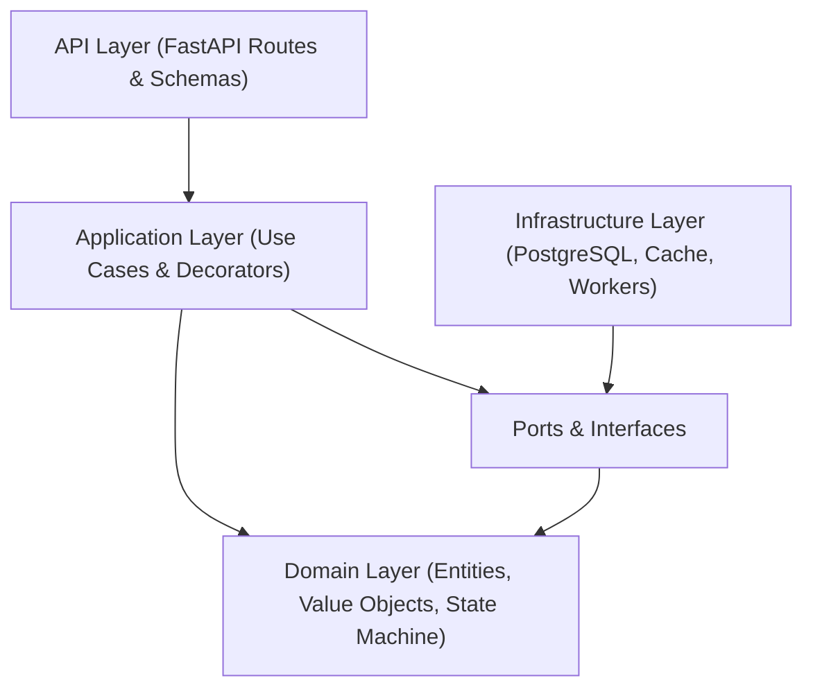

# System Architecture

## Architecture Overview

LedgerCore is a high-concurrency, distributed double-entry financial ledger engine built on **Clean / Hexagonal Architecture** (Ports and Adapters). Dependencies strictly flow inward toward the core domain.

## Layer Breakdown

### 1. Domain Layer (`app/domain/`)
- **Purity:** Pure business logic; zero external dependencies or I/O.
- **Entities:** [`Account`](file:///home/saimon/Emon_work/project/ledger_core/app/domain/models.py), [`Transaction`](file:///home/saimon/Emon_work/project/ledger_core/app/domain/models.py), [`LedgerEntry`](file:///home/saimon/Emon_work/project/ledger_core/app/domain/models.py).
- **Value Objects:** [`Money`](file:///home/saimon/Emon_work/project/ledger_core/app/domain/value_objects.py) (strict `decimal.Decimal` 2-decimal precision), `AccountId`, `TransactionId`, `Currency`.
- **State Machine:** [`TransactionStateMachine`](file:///home/saimon/Emon_work/project/ledger_core/app/domain/state_machine.py) (`PENDING` -> `POSTED` / `FAILED` / `REJECTED`).
- **Strategies:** [`FeeStrategy`](file:///home/saimon/Emon_work/project/ledger_core/app/domain/strategies/fee_strategy.py) (flat, percentage, tiered fees).

### 2. Ports Layer (`app/ports/`)
- Abstract base classes defining persistence, caching, idempotency, and messaging contracts:
  - [`repository_ports.py`](file:///home/saimon/Emon_work/project/ledger_core/app/ports/repository_ports.py): `IAccountRepository`, `ILedgerRepository`, `ITransactionRepository`, `IUnitOfWork`.
  - [`cache_port.py`](file:///home/saimon/Emon_work/project/ledger_core/app/ports/cache_port.py): `ICachePort`.
  - [`idempotency_port.py`](file:///home/saimon/Emon_work/project/ledger_core/app/ports/idempotency_port.py): `IIdempotencyStore`.
  - [`event_publisher_port.py`](file:///home/saimon/Emon_work/project/ledger_core/app/ports/event_publisher_port.py): `IEventPublisher`.

### 3. Application Layer (`app/application/`)
- **Use Cases:**
  - [`ExecuteTransferUseCase`](file:///home/saimon/Emon_work/project/ledger_core/app/application/use_cases/execute_transfer.py) & [`ExecuteTransferAsyncUseCase`](file:///home/saimon/Emon_work/project/ledger_core/app/application/use_cases/execute_transfer_async.py).
  - [`QueryBalanceUseCase`](file:///home/saimon/Emon_work/project/ledger_core/app/application/use_cases/query_balance.py).
  - [`AuditReconciliationUseCase`](file:///home/saimon/Emon_work/project/ledger_core/app/application/use_cases/audit_reconciliation.py) & [`AuditReconciliationAsyncUseCase`](file:///home/saimon/Emon_work/project/ledger_core/app/application/use_cases/audit_reconciliation_async.py).
- **Decorators & Resilience:**
  - [`idempotency_decorator.py`](file:///home/saimon/Emon_work/project/ledger_core/app/application/decorators/idempotency_decorator.py): At-most-once semantics with payload hash verification.
  - [`circuit_decorator.py`](file:///home/saimon/Emon_work/project/ledger_core/app/application/decorators/circuit_decorator.py): Isolates external dependency failures.

### 4. Infrastructure Layer (`app/infrastructure/`)
- **Persistence:** [`app/infrastructure/persistence/postgres/`](file:///home/saimon/Emon_work/project/ledger_core/app/infrastructure/persistence/postgres/) with SQLAlchemy 2.0 + asyncpg, atomic `PostgresUnitOfWork`, and fallback memory repositories.
- **Concurrency & Deadlock Prevention:** [`CanonicalLockManager`](file:///home/saimon/Emon_work/project/ledger_core/app/infrastructure/concurrency/lock_manager.py) enforces monotonic resource sorting ($ID_A < ID_B$) to eliminate circular wait (Coffman deadlocks).
- **Resilience & DSA:**
  - [`CircuitBreaker`](file:///home/saimon/Emon_work/project/ledger_core/app/infrastructure/resilience/circuit_breaker.py) (Closed / Open / Half-Open).
  - [`LRUTTLCache`](file:///home/saimon/Emon_work/project/ledger_core/app/infrastructure/dsa/lru_ttl_cache.py) with doubly-linked list + hash map.
  - [`PriorityRetryHeap`](file:///home/saimon/Emon_work/project/ledger_core/app/infrastructure/dsa/priority_retry_heap.py) min-heap for exponential backoff retries.
  - [`ThreadSafeWorkerPool`](file:///home/saimon/Emon_work/project/ledger_core/app/infrastructure/os_threading/worker_pool.py) thread pool for asynchronous background processing.

### 5. API Layer (`app/api/`)
- FastAPI application entry point: [`app/api/main.py`](file:///home/saimon/Emon_work/project/ledger_core/app/api/main.py).
- Dependency injection container: [`app/api/dependencies.py`](file:///home/saimon/Emon_work/project/ledger_core/app/api/dependencies.py).
- Routers: [`transfers.py`](file:///home/saimon/Emon_work/project/ledger_core/app/api/routes/transfers.py), [`accounts.py`](file:///home/saimon/Emon_work/project/ledger_core/app/api/routes/accounts.py), [`audit.py`](file:///home/saimon/Emon_work/project/ledger_core/app/api/routes/audit.py), [`health.py`](file:///home/saimon/Emon_work/project/ledger_core/app/api/routes/health.py).

## Detailed Reference Documentation
For deep-dive architectural specifications, refer to:
- [02_ARCHITECTURE_AND_LLD_PATTERNS.md](file:///home/saimon/Emon_work/project/ledger_core/docs/02_ARCHITECTURE_AND_LLD_PATTERNS.md)
- [03_CORE_CS_DEEP_DIVE.md](file:///home/saimon/Emon_work/project/ledger_core/docs/03_CORE_CS_DEEP_DIVE.md)
- [04_MODULE_AND_COMPONENT_SPECIFICATIONS.md](file:///home/saimon/Emon_work/project/ledger_core/docs/04_MODULE_AND_COMPONENT_SPECIFICATIONS.md)
- [06_END_TO_END_SYSTEM_FLOW_DIAGRAM.md](file:///home/saimon/Emon_work/project/ledger_core/docs/06_END_TO_END_SYSTEM_FLOW_DIAGRAM.md)
